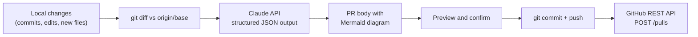

# claude-pr

A command-line tool that turns your local git changes into a GitHub pull request. It sends
the diff to Claude, which writes the title, summary, change list, test checklist and a
Mermaid diagram of how the changed parts connect. Then it commits, pushes and opens the PR
through the GitHub REST API. Every PR body it opens has the diagram in an `## Architecture`
section, and GitHub renders it inline.

## How it works



## Setup (one time)

You need Python 3.10+, git, an [Anthropic API key](https://console.anthropic.com/) and access to GitHub.

```bash
git clone https://github.com/anudeepdevineni/claude-pr.git
cd claude-pr
pip install -e .
```

This installs the `claude-pr` command. Then set your Anthropic key:

```powershell
# Windows PowerShell (current window)
$env:ANTHROPIC_API_KEY = "sk-ant-..."
# Windows, permanently (open a new terminal afterwards)
setx ANTHROPIC_API_KEY "sk-ant-..."
```

```bash
# macOS / Linux
export ANTHROPIC_API_KEY="sk-ant-..."
```

For GitHub, nothing extra is needed if you've already run `gh auth login`; the tool reuses that
login. Otherwise set `GITHUB_TOKEN` to a token with **Contents: write** and **Pull requests: write**.

## Usage

Run it inside any GitHub repository that has changes:

```bash
claude-pr --dry-run            # preview the generated PR; changes nothing
claude-pr                      # preview, confirm, then commit + push + open the PR
claude-pr --draft              # open as a draft PR
claude-pr --base develop       # target a branch other than the default
claude-pr -y                   # skip the confirmation prompt
```

What it does:

- **On the base branch** (e.g. `main`): creates a new branch with the name Claude suggests
  (e.g. `feat/payment-retries`, plus `-2` if that's taken) and commits your changes there.
- **On a feature branch**: commits to that branch and opens the PR from it.
- The PR covers everything that isn't on `origin/<base>` yet: unpushed commits, edits and
  new untracked files. Lock files are left out of what Claude reads so they don't drown the
  real change.
- `--dry-run` never touches your files, staging area or branches.

## Testing

### 1. Automated tests (no API keys, no internet)

```bash
pip install -e .
python -m unittest -v
```

The end-to-end tests build a real git repo with a local "origin" and point the tool at a fake
server that stands in for the Claude and GitHub APIs. They check that:

- Claude receives the whole change, including brand-new files, and is asked for structured JSON
- a branch is created, the commit is pushed to the remote and the working tree ends up clean
- GitHub receives the right `head`, `base`, title, `draft` flag and a body with a ```` ```mermaid ```` block
- an existing feature branch is reused, and a taken branch name gets a `-2` suffix
- `--dry-run` changes nothing, and a repo with no changes exits before calling any API

### 2. Live test on a throwaway GitHub repo

```bash
gh repo create claude-pr-playground --private --clone --add-readme
cd claude-pr-playground
```

Make a change, for example create `calc.py` with a couple of functions and edit `README.md`, then:

```bash
claude-pr --dry-run    # check the title, summary and diagram in the terminal
claude-pr              # press Enter to confirm
```

Open the printed PR URL. The **Architecture** section should render as a diagram, not as code.
When you're done, delete the repo on GitHub (Settings → Delete), or with
`gh auth refresh -s delete_repo` followed by `gh repo delete claude-pr-playground --yes`.

## Bonus: the same workflow as a Claude Code slash command

[`.claude/commands/create-pr.md`](.claude/commands/create-pr.md) does the same job from inside
Claude Code, using Claude Code itself instead of an API key (it needs `gh`). Copy it into a
repo's `.claude/commands/` folder, or into `~/.claude/commands/` to use it in every repo, then
type `/create-pr` (or `/create-pr develop` to choose the base branch) in Claude Code.

## Configuration

| Environment variable | Purpose |
| --- | --- |
| `ANTHROPIC_API_KEY` | Claude API key (required) |
| `GITHUB_TOKEN` / `GH_TOKEN` | GitHub token; falls back to `gh auth token` |
| `GITHUB_API_URL` | GitHub Enterprise API URL (default `https://api.github.com`) |

The model is `claude-opus-5-5` (the `MODEL` constant in `claude_pr.py`). If its safety
classifier declines a diff, the request is retried server-side on Anthropic's recommended
fallback model.

## Files

| File | What it is |
| --- | --- |
| `claude_pr.py` | The whole CLI (~250 lines) |
| `test_claude_pr.py` | Unit and end-to-end tests |
| `pyproject.toml` | Packaging; defines the `claude-pr` command |
| `.claude/commands/create-pr.md` | Claude Code slash command version |
